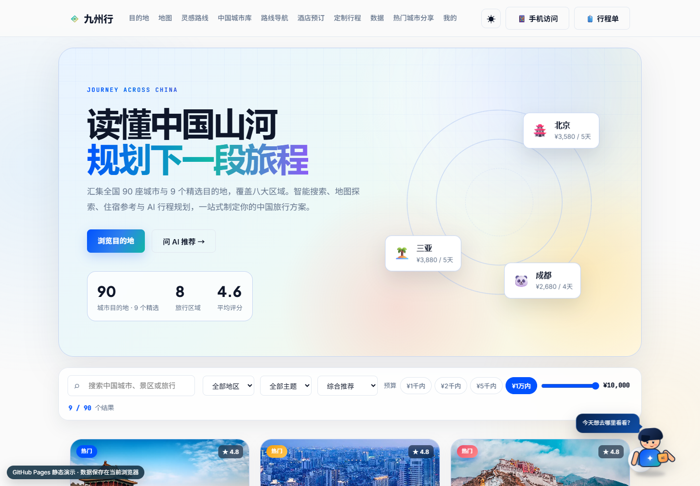
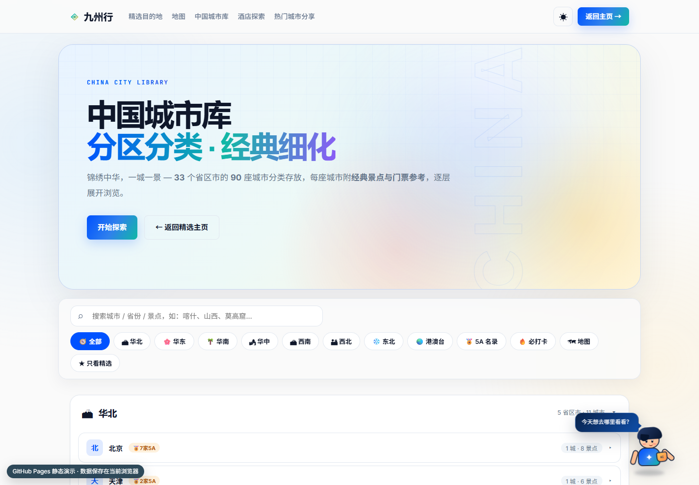
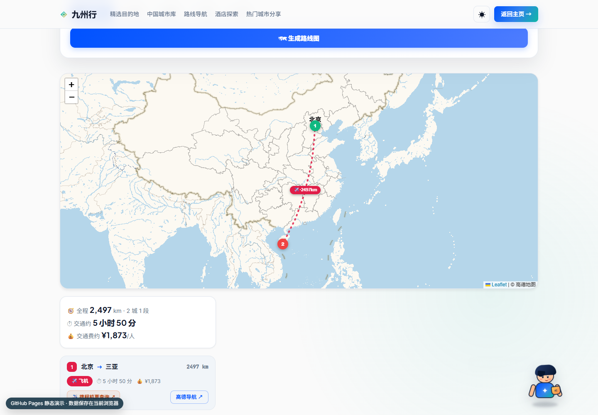
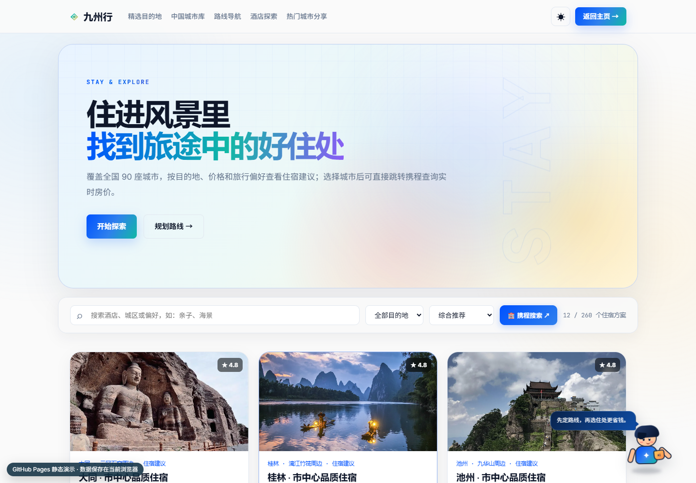
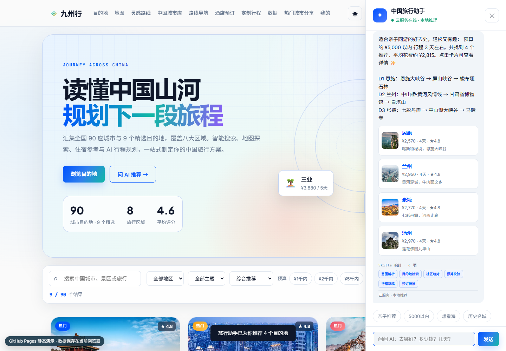
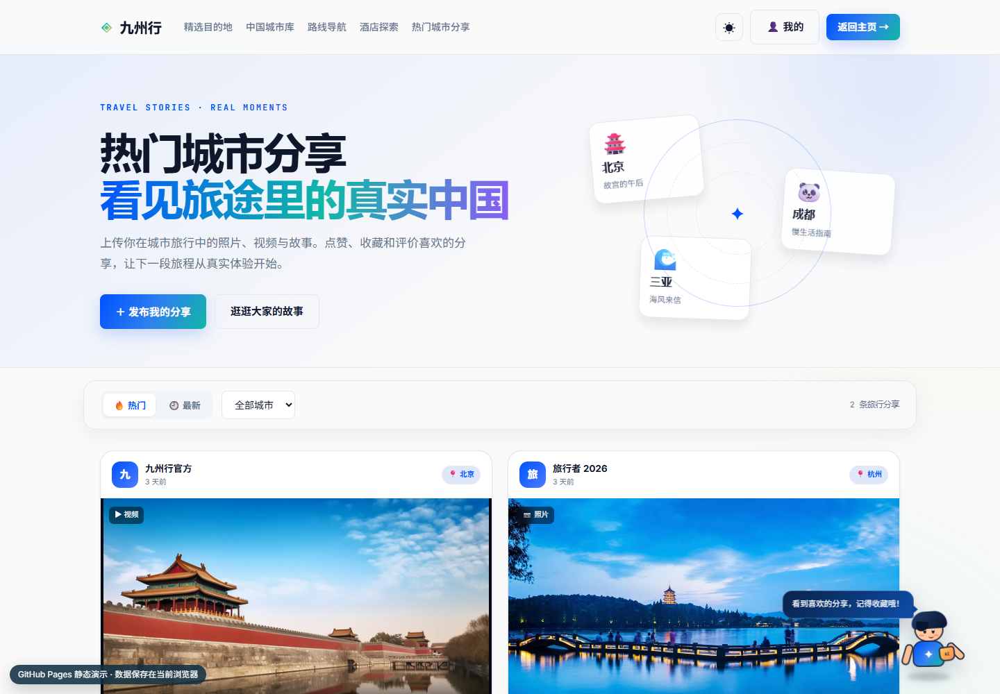
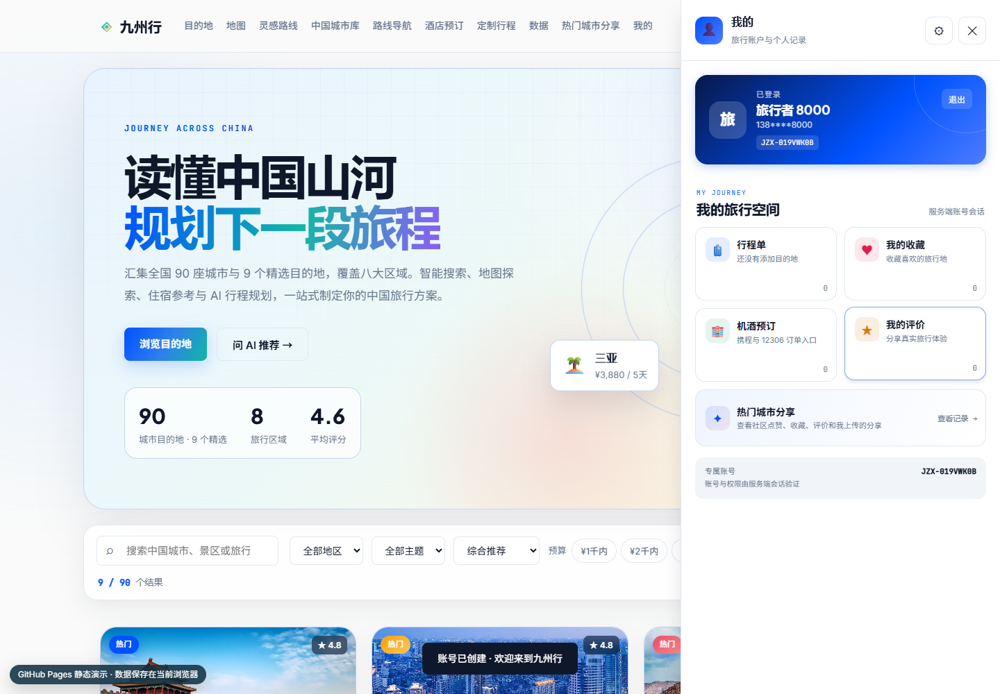
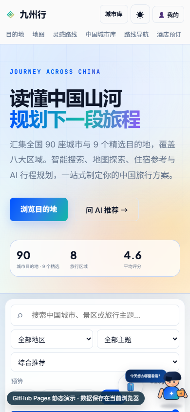
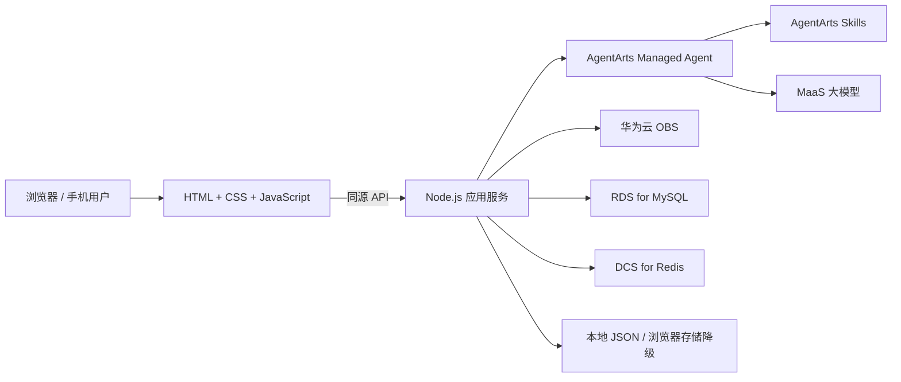

# 九州行 · 中国旅行规划平台

> 第十一届华为 ICT 大赛中国创新赛参赛作品  
> 基于华为云 CodeArts、AgentArts、MaaS、Skills、OBS、RDS for MySQL 与 DCS for Redis 的 AI 旅行规划应用

[在线体验](https://xiaosihhh.github.io/jiuzhouxing/) ·
[项目源码](https://github.com/xiaosihhh/jiuzhouxing) ·
[竞赛材料](#竞赛与开发证据) ·
[本地运行](#本地完整运行)



## 项目简介

九州行面向中国自由行和周边游用户，将城市发现、景点介绍、路线规划、酒店参考、AI 行程助手、旅行社区和个人旅行记录整合到一个网页应用。

用户只需要输入出发地、目的地、天数、人数和预算，就可以获得结构化的目的地推荐、预算拆分和日程草案，并继续进行路线调整、行程收藏和旅行分享。

项目重点解决四个问题：

- **信息分散**：城市、景点、路线、住宿和社区内容分布在多个平台。
- **规划耗时**：用户需要反复搜索、比较和手工整理行程。
- **预算难控**：交通、住宿和景点费用缺少统一参考。
- **方案难复用**：已有行程、收藏和旅行经验难以保存与再次使用。

## 在线演示说明

当前 GitHub Pages 地址为：

**https://xiaosihhh.github.io/jiuzhouxing/**

公开网页是**静态演示版**，用于让评委和用户直接体验界面与主要交互：

- 城市、景点、路线、酒店和社区数据随项目本地分发。
- 登录、点赞、收藏、评论和行程记录保存在当前设备的浏览器中。
- 静态演示验证码固定为 `123456`。
- 不同设备之间的数据暂不实时同步。

完整本地版本可以接入华为云智能体、RDS for MySQL、DCS for Redis 和 OBS。项目已经完成真实云资源连接验证，验证后为停止持续计费已释放实例；相关代码、验证脚本和截图证据均保留在仓库中。

## 核心功能

| 模块 | 主要能力 |
| --- | --- |
| 首页发现 | 90 座城市、9 个精选目的地、预算筛选、主题筛选、搜索、地图探索 |
| 中国城市库 | 8 大区域、33 个省区市、43 个经典景点、5A 名录、城市详情和景点介绍 |
| 路线导航 | 起点、终点、多个途经城市、自驾/高铁/飞机/大巴、地图路线、时间与费用估算 |
| 酒店探索 | 90 座城市住宿建议、筛选排序、酒店详情、携程查询外链 |
| AI 旅行助手 | 自然语言需求理解、目的地推荐、预算校验、行程生成、六项 Skills 执行展示 |
| 热门城市分享 | 图文/视频分享、城市筛选、点赞、收藏、评论和个人发布记录 |
| 我的 | 手机号登录、随机账号、行程单、收藏、机酒记录、评价、修改密码 |
| 多端适配 | 桌面、平板、手机和暗色模式 |

### 首页与目的地发现

首页集中展示精选目的地、热门城市、旅行地图、主题路线、热门景点排行、社区视频和旅行热搜。预算默认限制在 `¥1,000–¥10,000`，支持按区域、主题、价格、评分和天数筛选。


### 中国城市库与景点详情

城市库按八大区域和省市逐层展开，每座城市包含经典景点、门票参考和旅行说明。用户可以查看全部城市、只看精选、5A 名录、必打卡榜或切换到地图模式。



### 自选路线与导航

用户可以自由组合起点、终点和多个途经城市，选择自驾、高铁、飞机或大巴。系统生成地图折线、里程、预计耗时和交通费用，并提供高德导航、12306 和携程机票查询入口。



### 酒店探索

酒店页按目的地、价格和旅行偏好展示住宿区域与类型建议。当前页面包含 260 个住宿推荐方案，选择城市后可以跳转携程查询实时房价。



### AI 旅行助手

AI 助手支持“亲子游”“预算 5000 元以内”“想看海”“历史文化名城”等自然语言问题。每次请求先执行六项可追踪 Skills，再由 AgentArts Managed Agent 或 MaaS 模型在业务结果范围内生成说明。

行程规划器会严格校验用户要求的天数，支持“三天”“3天”“三天两晚”等表达；指定单一城市时，会生成经典首次游、亲子轻松游和城市文化游等可切换方案，并识别迪士尼、环球影城等全天景点，避免把全天项目与其他景点硬塞在同一天。

六项 Skills：

1. 意图解析
2. 目的地检索
3. 社区趋势
4. 预算校验
5. 行程草稿
6. 预订衔接



### 热门城市分享

社区支持图片、视频、旅行配文、城市筛选、点赞、收藏和评论。完整版本由后端接收媒体并上传至华为云 OBS，私有对象通过短时签名地址访问。



### 我的旅行空间

用户通过手机号登录后获得专属随机账号，可以查看行程单、收藏、机酒预订、评价和社区记录。设置页支持创建或修改登录密码，之后可以使用密码或验证码登录。



### 手机端

页面已经适配桌面、平板和手机，核心功能在窄屏下仍可正常操作。



## 华为云能力



| 华为云能力 | 项目用途 |
| --- | --- |
| CodeArts 代码智能体 | 需求拆解、代码生成、联调修复、测试和文档整理 |
| AgentArts Managed Agent | 运行旅行规划智能体，生成对话和结构化推荐 |
| MaaS | 提供大模型推理能力 |
| AgentArts Skills | 执行意图解析、目的地检索、预算校验等业务能力 |
| OBS | 保存社区图片和视频，生成短时签名访问地址 |
| RDS for MySQL | 保存用户、对话和行程等结构化数据 |
| DCS for Redis | 缓存高频 AI 规划和城市数据 |

### 云服务安全与降级

- 浏览器不持有 AK/SK、AgentArts Key 或数据库密码。
- 密钥只存在于服务端 `.env`，不会提交到仓库。
- 用户密码采用 `scrypt` 哈希，会话 Cookie 使用 `HttpOnly` 和签名校验。
- RDS 或 Redis 不可用时自动降级到本地 JSON 和进程内缓存。
- 静态演示版使用浏览器存储，不依赖线上云实例。

真实接入结果与停止费用后的释放说明：

- [RDS 接入证据](docs/evidence-rds.png)
- [Redis 接入证据](docs/evidence-redis.png)
- [云服务验证页面](docs/cloud-service-evidence.html)

## 技术栈

- 前端：HTML5、CSS3、原生 JavaScript、Leaflet
- 后端：Node.js、HTTP API、文件存储
- 智能体：华为云 AgentArts Managed Agent、MaaS、Skills
- 数据：RDS for MySQL、DCS for Redis、本地 JSON 降级
- 对象存储：华为云 OBS
- 部署：Docker、GitHub Pages 静态构建
- 安全：scrypt、HttpOnly 会话、服务端权限校验

## 项目结构

```text
index.html                 首页与 AI 助手
cities.html                中国城市库
route.html                 路线规划
hotel.html                 酒店探索
community.html             热门城市分享
js/                        页面交互、数据与静态 API 层
assets/cities/             90 张本地城市封面
backend/                   Node.js API、AgentArts、RDS、Redis、OBS 适配
agentarts-skills/          AgentArts Skills 导出包
.codeartsdoer/skills/      CodeArts 项目级 Skills
docs/                      GitHub Pages 站点、截图与竞赛材料
deliverables/              答辩 PPT/PDF
Dockerfile                 云端镜像
docker-compose.yml         本地应用 + MySQL + Redis
```

## 本地完整运行

### 仅浏览前端

```powershell
powershell -ExecutionPolicy Bypass -File .\start-server.ps1
```

访问：<http://localhost:8000/>

### 启动完整后端

```powershell
powershell -ExecutionPolicy Bypass -File .\start-full.ps1
```

主要接口：

```text
GET  /api/health
GET  /api/auth/me
POST /api/auth/code
POST /api/auth/login/code
POST /api/auth/login/password
POST /api/auth/password
POST /api/ai/plan
POST /api/trips
GET  /api/trips
GET  /api/community/posts
POST /api/community/posts
```

### Docker

```powershell
docker compose up --build
```

## 环境变量

复制 `.env.example` 为 `.env`，填写服务端配置：

```text
AGENTARTS_CHAT_URL=
AGENTARTS_API_KEY=
DATABASE_URL=
REDIS_URL=
OBS_ENDPOINT=
OBS_BUCKET=
OBS_ACCESS_KEY=
OBS_SECRET_KEY=
```

`.env`、用户数据、对话记录、日志和云资源文件已加入 `.gitignore`，不会进入公开仓库。

## GitHub Pages 静态构建

```powershell
powershell -ExecutionPolicy Bypass -File .\tools\build-github-pages.ps1
```

构建结果写入 `docs/`，GitHub Pages 发布源配置为：

```text
Branch: main
Folder: /docs
```

静态模式由 `js/static-api.js` 自动启用，不影响本地完整后端版本。

## 验证结果

- 首页、城市库、路线、酒店、社区页面均可打开。
- GitHub Pages 桌面端和手机端均可访问。
- 社区视频、图片、点赞、收藏和评论界面正常。
- 手机号登录、随机账号、“我的”面板和密码设置可用。
- 自动化检查覆盖城市数据唯一性、景点引用、主要接口和主要页面。
- 当前 GitHub Pages 页面测试无 JavaScript 控制台错误。

## 竞赛与开发证据

- [CodeArts 使用记录说明](docs/codearts-evidence/CodeArts使用记录说明-WPS.pdf)
- [答辩 PPT](deliverables/jiuzhouxing-competition-deck-v1.2.0.pptx)
- [答辩 PDF](deliverables/jiuzhouxing-competition-deck-v1.2.0.pdf)
- [系统架构](docs/ARCHITECTURE.md)
- [演示脚本](docs/DEMO_SCRIPT.md)
- [页面排版审计](docs/LAYOUT_AUDIT.md)
- [竞赛行动清单](docs/COMPETITION_ACTION_PLAN.md)

## 已知边界

- GitHub Pages 为单机静态演示，账号和社区数据不会跨设备同步。
- 酒店与价格是作品演示数据，不代表实时库存。
- AI 静态版使用本地推荐引擎；完整版可接入 AgentArts Managed Agent。
- 真实 RDS、Redis 和 OBS 配置需要自行提供云资源和环境变量。

## 开源许可

项目使用 [MIT License](LICENSE)。第三方地图、字体和图片来源说明见项目内对应文件。
