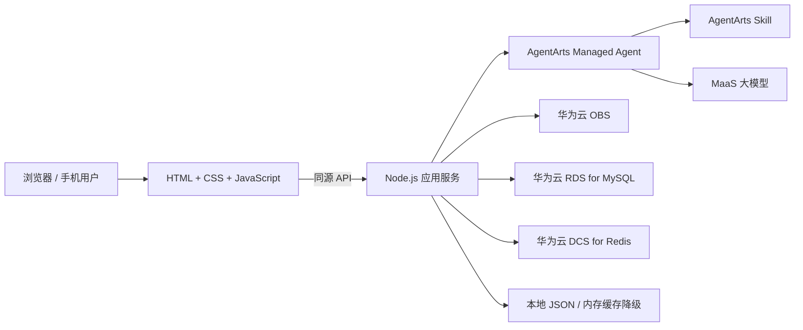

# 九州行系统架构

## 请求链路

1. 用户在旅行助手输入目的地、预算、天数或偏好。
2. Node.js 服务执行旅行意图、目的地检索、社区趋势、预算校验、行程草稿和预订衔接六项业务 Skills。
3. 服务将校验后的候选城市和预算上下文提交 AgentArts Managed Agent。
4. AgentArts Skill 与 MaaS 模型生成结构化回答。
5. 服务校验城市 id、预算和行程后返回前端。
6. 相同请求可写入 DCS；部署环境的数据写入 RDS。
7. 社区媒体经后端上传 OBS，私有对象通过短时签名地址访问。

## 安全边界

- 浏览器只访问同源 API，不持有华为云 AK/SK。
- 智能体 Key、OBS Key、RDS 与 Redis 凭据只存在服务端环境变量。
- 用户密码使用 scrypt 哈希，会话 Cookie 使用 HttpOnly 和签名校验。
- `.env`、用户数据和日志均由 `.gitignore` 排除。
