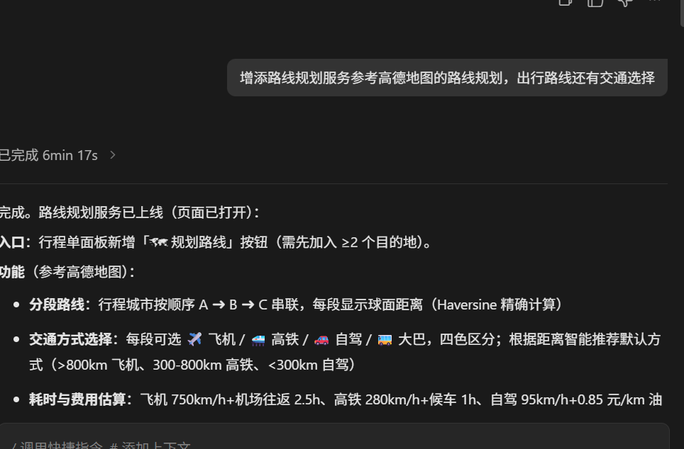
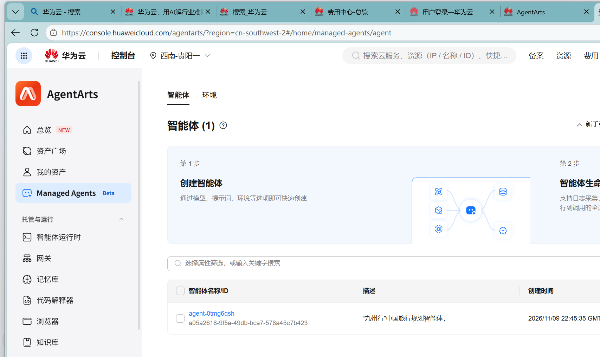
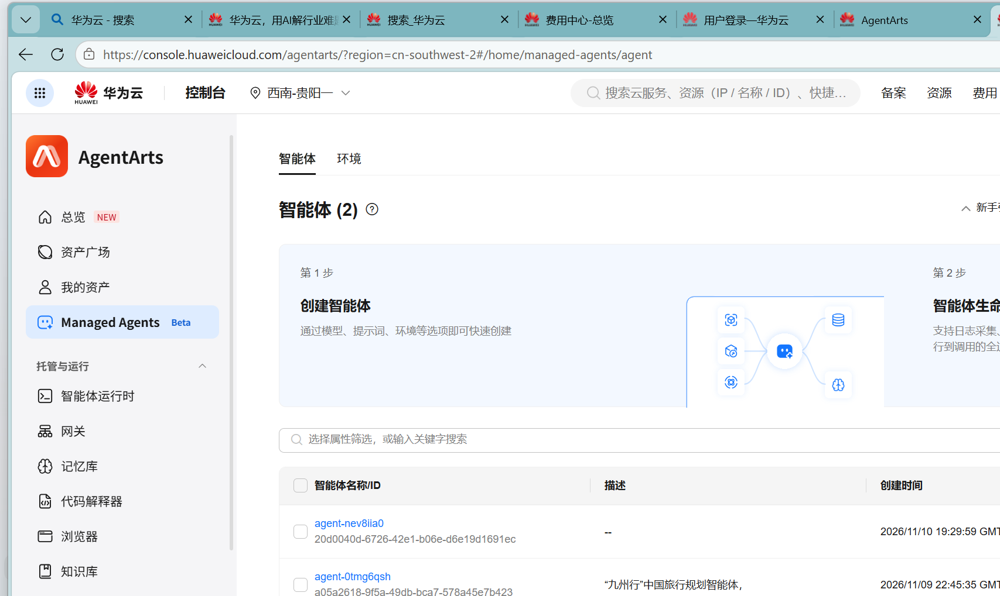
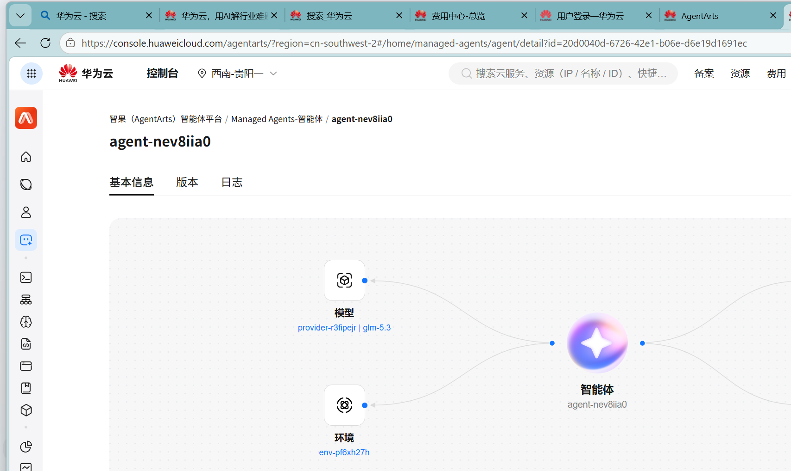
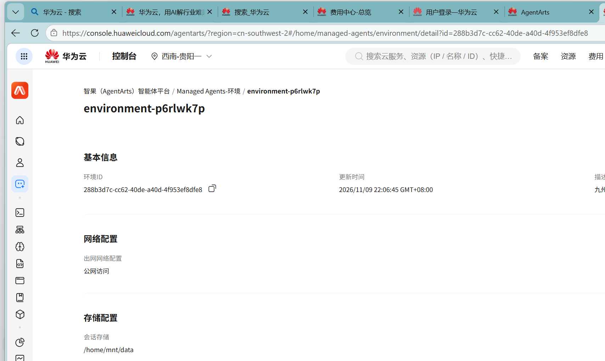
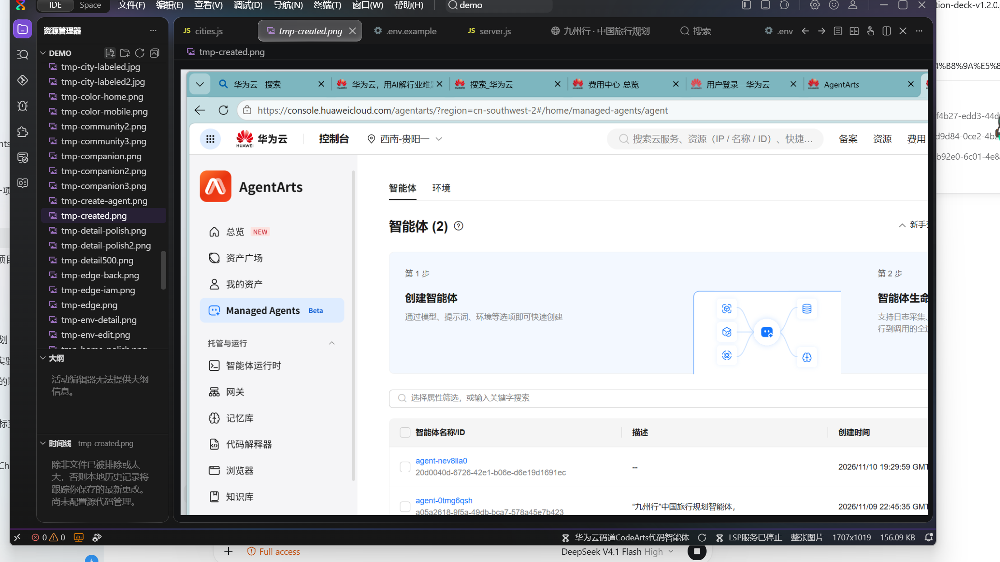
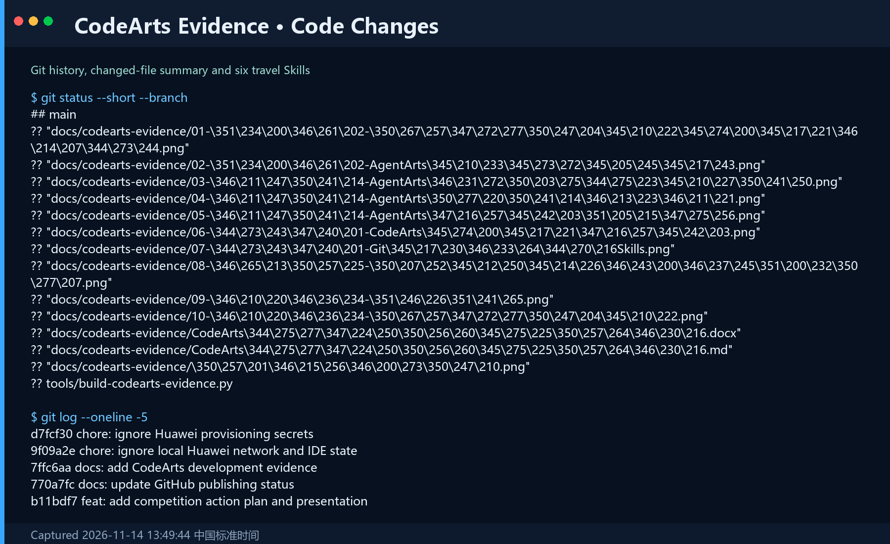
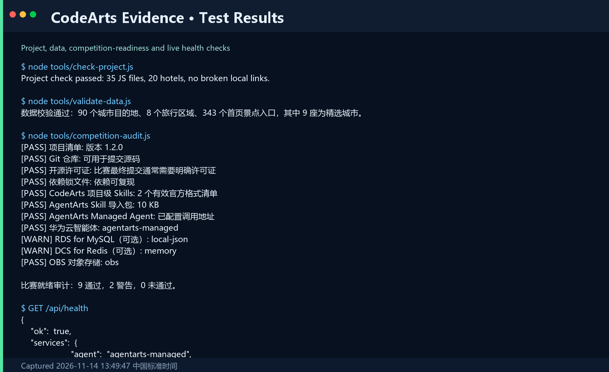
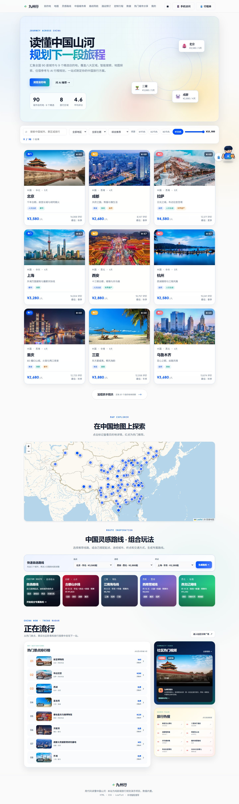
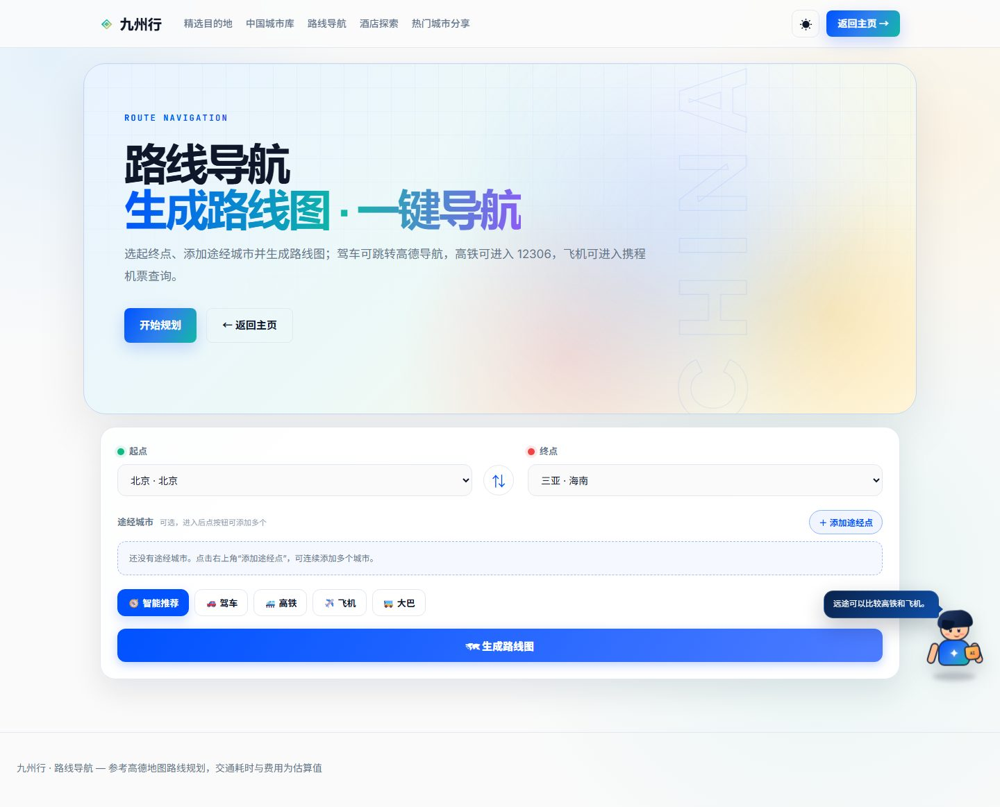

# CodeArts 使用记录说明

项目：九州行 · 中国旅行规划平台

生成日期：2026-11-14

说明：以下 10 张截图来自当前 CodeArts 开发环境、华为云 AgentArts 控制台和此前保存的项目开发版本。

## 01-需求-路线规划开发指令.png

- 阶段：需求
- 说明：用户提出路线规划、交通方式、耗时和费用估算需求，智能体返回完成结果。
- SHA-256：`d21febb2feaa760b553ecfb53b938101c21a8021c8e8c542ccddbb332a3398bc`

## 02-需求-AgentArts创建入口.png

- 阶段：需求
- 说明：在华为云 AgentArts 中创建托管智能体，进入模型、提示词和环境配置流程。
- SHA-256：`5f7bb17fd632ed53090d7b5333c084b207915c15671d61d21c2029bf99645466`

## 03-执行-AgentArts智能体列表.png

- 阶段：智能体执行
- 说明：AgentArts 控制台显示已创建的智能体及其创建时间。
- SHA-256：`1e623c5112487991399de52306455f40b4094e331d2a4f7ec0a011a9571f9551`

## 04-执行-AgentArts运行拓扑.png

- 阶段：智能体执行
- 说明：展示 Managed Agent、运行时、模型、浏览器和知识库之间的运行关系。
- SHA-256：`0c44ad53daca2732f18c656bca1ce85aee88ab10e3d287e44486e15235a4de97`

## 05-执行-AgentArts环境配置.png

- 阶段：智能体执行
- 说明：展示 AgentArts 托管环境、Agent 关联和运行状态。
- SHA-256：`c8dad055c027361afe80fef3b2d0f080bbd0058ec4f49225f7fc0c22eeb8b92a`

## 06-代码-CodeArts开发环境.png

- 阶段：代码变更
- 说明：IDE 同时展示项目源码、截图资源和华为云 AgentArts 控制台，底部明确显示“华为云码道CodeArts代码智能体”。
- SHA-256：`b970463733796aad1b5da77506123c5fd98fd435e93026f6b54d94191d385279`

## 07-代码-Git变更与Skills.png

- 阶段：代码变更
- 说明：展示 Git 提交、变更文件统计和 six travel Skills 的实际实现代码。
- SHA-256：`90caa5ddc4642e29d63da14c58b639fe753c1dbb970bf2534d9fd2330f3122de`

## 08-测试-自动化检查通过.png

- 阶段：测试结果
- 说明：项目结构、数据、比赛就绪度和运行健康检查结果。
- SHA-256：`30210b7968a1c22271b774d7fd3d2a1062201072f1697b8b73dbe777d7eb2e2a`

## 09-成果-首页.png

- 阶段：交付结果
- 说明：首页最终版本，包含 AI 助手、目的地、地图、路线、酒店和社区入口。
- SHA-256：`e234b0eb8c4c0e79e2d06c7b7b633883bd3e1a9115713cb1f5efa84c8cd031a4`

## 10-成果-路线规划.png

- 阶段：交付结果
- 说明：最终路线规划页面，支持起终点、途经城市、交通方式和路线生成。
- SHA-256：`b65acf3ab081bae9cb47710418e84fa92ca32bf8866dd1636e8d16e785ba2486`

